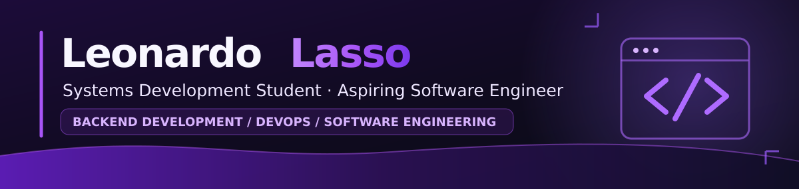
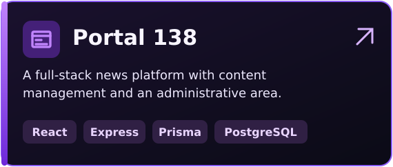
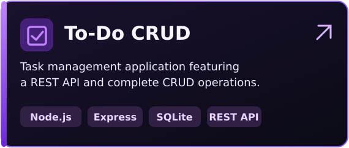
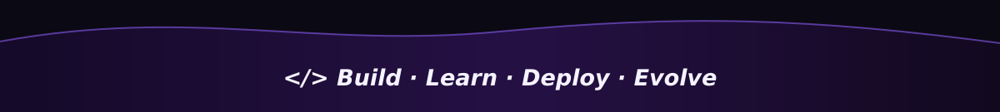

<!-- GitHub profile README | github.com/lassozx -->

  
    
  
  
    
  <strong>Software Engineering · Backend Development · DevOps</strong>

 

<h2 align="center">✦ About Me</h2>

  I'm a <strong>Systems Development student at SENAI</strong> in Brazil who enjoys building applications
  and understanding how software works beyond the interface.
  I'm working toward a career in <strong>Software Engineering</strong>, with particular interests in
  <strong>Backend Development</strong>, <strong>DevOps</strong> and reliable systems.

  After completing my technical program, I plan to pursue a
  <strong>Bachelor's degree in Computer Science</strong> to deepen my foundation in algorithms,
  computing systems, and software design.

 

<h2 align="center">✦ Tech Stack &amp; Tools</h2>

<strong>Languages &amp; Frontend</strong>

  

<strong>Backend &amp; Databases</strong>

  

<strong>Development Tools</strong>

  

Technologies I have worked with or am currently exploring. This isn't a claim of expert proficiency.

 

<h2 align="center">✦ Areas of Focus</h2>

<table>
<tr>
<td width="50%" valign="top">
<h3 align="center">⚙️ Backend Development</h3>

<strong>APIs · Authentication · Business Logic</strong>

Building server-side applications, organizing code, and connecting systems to databases.

</td>
<td width="50%" valign="top">
<h3 align="center">♾️ DevOps</h3>

<strong>Linux · Containers · CI/CD</strong>

Developing my understanding of deployment, automation, infrastructure, and reliable delivery.

</td>
</tr>
<tr>
<td width="50%" valign="top">
<h3 align="center">🏗️ Software Engineering</h3>

<strong>Architecture · Testing · Maintainability</strong>

Learning to design systems that are clear, reliable, and easier to evolve over time.

</td>
<td width="50%" valign="top">
<h3 align="center">🗄️ Databases &amp; CS Foundations</h3>

<strong>SQL · Data Modeling · Algorithms</strong>

Strengthening my knowledge of relational databases, problem-solving, and computing fundamentals.

</td>
</tr>
</table>

 

<h2 align="center">✦ Featured Projects</h2>

  
  

Click on a project to explore its code, documentation, and architecture.

 

<h2 align="center">✦ Currently Working On</h2>

  Backend fundamentals &amp; REST APIs · Linux &amp; containerization · Software architecture · English for international opportunities

 

<h2 align="center">✦ My Roadmap</h2>

  <strong>Now:</strong> Complete my technical program in Systems Development at SENAI. 
  <strong>Next:</strong> Pursue a Bachelor's degree in <strong>Computer Science</strong>. 
  <strong>Long term:</strong> Become a <strong>Software Engineer</strong> specializing in <strong>Backend</strong> and <strong>DevOps</strong>, and contribute to impactful projects.

 

  

